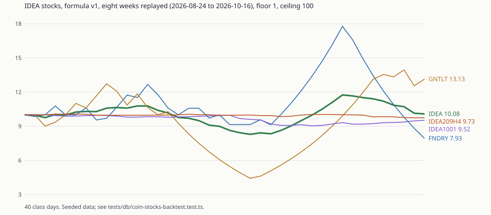
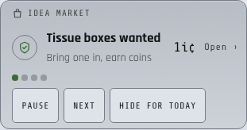
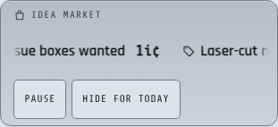
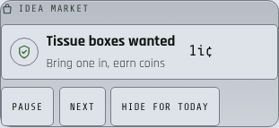

Mr. Pina chose six later features on 2026-10-17 ("build out the student
marketplace, marketplace reviews, student to student transfers, header banner,
buy hall pass time, and the stock market"). Decision 70 records them with
their defaults; `docs/coin-economy/IDEA_COIN_V2.md` section 12 is the spec.
This session ran unattended (a scheduled routine), in solo mode, from a
detached HEAD, which is why this file is named for the ledger rather than for
a branch.

## What shipped

- **0275** reserves `market` as a short link (the new top-level route would
  otherwise be shadowed by, or shadow, a short link of that name). It is its
  own file so `tests/short-link-reserved-names.test.ts`'s minimal chain can
  apply it without the coin chain.
- **0276, the IDEA Market** (`/market`): listings, orders and reviews; escrow
  through `_coin_market_settle`, the one writer of release, refund and split;
  auto release after 5 class days inside `coin_autopay_run`; staff moderation
  on a new Coin Desk area, `/coin-desk/market` (disputes, feature, hide with a
  reason, official cards, review removal); listing photos in the existing
  private `coin-uploads` bucket (`coin_can_read_upload` widened to a live,
  unhidden listing's photo). Every new setting's validation is
  `_coin_setting_ok_0402`, which the redefined `_coin_setting_ok` calls last.
- **0277, transfers**: a PIN hashed with `extensions.crypt` (bcrypt; a salted
  SHA-256 fallback where pgcrypto is not installed), five wrong tries lock
  sending for 15 minutes, a 20 coin daily cap, never in debt, public by
  default (`coin_public_transfers`, the Ledger's new Transfers tab, the
  market's feed); private costs 10% (at least 0.1) and is filtered out of
  `coin_public_transactions` and `coin_public_student` too.
- **0278, hall pass time**: 5-minute blocks at 1 coin, at most 15 minutes a
  day, from the hall pass card and the coin page. `_classroom_hall_pass_budget`
  adds bought seconds to the day; `_classroom_hall_pass_check` moves the warn
  and fine thresholds later by the minutes bought before the pass opened,
  clamped at the auto check-in cap.
- **0279, the stock market** (`/market/stocks` and one page per stock): closes
  with stored inputs and `formula_version` `v1`, the nightly writer
  `_coin_stocks_nightly`, house trades with a 2% fee each way and a 50-coin
  cost-basis cap, no shorting, portfolio leaderboard, `coin_public_stocks` for
  the Ledger's index tile.
- **0280, the classroom header banner**: `coin_banner_pins`, three looks, the
  look a coin setting (`banner_style`, default `spotlight`), mounted once in
  the classroom layout over the class pages (not on the full-height console
  pages, not in view-as).
- **0281**: `coin_economy_health` for the digest, `coin_autopay_run` now also
  auto-releases sales and writes stock closes, and `coin_public_reasons` gains
  a sentence for every new fee and limit.

## The backtest

`node tools/coin-stock-backtest.mjs` runs `tests/db/coin-stocks-backtest.test.ts`
(the real migrations, a seeded eight weeks: two classes of 18 and 12 getting
work back two or three days a week with one hard test in week five, a Foundry
spike in week six, a dry GAUNTLET week four) through the real nightly run.
Result on 2026-10-19: 40 class days, 5 stocks, **no close at the floor or the
ceiling**.

| Stock | First | Last | Low | High |
|---|---|---|---|---|
| IDEA (index) | 10.00 | 10.08 | 8.29 | 11.74 |
| FNDRY | 10.00 | 7.93 | 7.93 | 17.77 |
| GNTLT | 10.00 | 13.13 | 4.42 | 13.94 |
| IDEA100 Block 1 | 10.00 | 9.52 | 9.03 | 10.00 |
| IDEA209H Block 4 | 10.00 | 9.73 | 9.73 | 10.07 |

CSV: `docs/coin-economy/backtests/2026-10-19-stocks-v1.csv`. The one finding
worth a decision later: **class stocks barely move** (a 0.3 point range for a
class whose grades are steady), because a grade ratio over a trailing four
weeks is a smooth signal against its own median. That is honest rather than
broken; a teacher wanting livelier class stocks would shorten
`stock_class_window_weeks`.

## The banner candidates

Three looks over the same four pins, measured at 375 and 1440 on the IDEA
theme and on Space White (`tools/browser-verify/routes/coin-market-banner*.mjs`,
0 outside threshold). **Spotlight is the default**: one pin at a time is the
least competition for a class page's own header, it is one line tall at every
width, and it is the only look whose pin names never truncate.

| Look | IDEA, 1440 | Space White, 375 |
|---|---|---|
| Spotlight (default) |  |  |
| Ticker |  |  |
| Cards |  |  |

All twelve pictures (three looks, two themes, two widths) are in
`docs/coin-economy/banner-candidates/`.

## Measured

- `svelte-check`: 0 errors, 33 warnings in 18 files (the baseline, unchanged).
- Database tests (new): `coin-market-escrow` 15, `coin-transfer-pin` 8,
  `coin-hallpass-minutes` 7, `coin-stocks-pricing` 11,
  `coin-market-conservation` 2 (a seeded walk of 260 actions, plus a planted
  unbalanced release the arithmetic catches), `coin-stocks-backtest` 1.
- Client tests: `tests/coin-market-client.test.ts` 12, `tests/coin-stocks-client.test.ts` 7.
- Full `npm test` once: 855 of 860 files passed; of the 5, three were this
  container's shallow clone (`apply-migration-guard`, `apply-migration-trace`,
  `identity-style-shared` read git history) and two were this bundle's own
  (the connector registry and the short link chain), fixed; all five re-run
  green after unshallowing, 165 of 165.
- Mutation proof, five mutants, all killed and restored md5-identical: a
  private transfer in the public feed, a private row in the public ledger, a
  hidden listing on the board, a dispute resolvable outside a section's scope,
  and a hall pass threshold moved by minutes bought after the pass opened.
- Browser pass, 15 new specs at 375 and 1440: 30 runs, 400 measurements, 0
  outside threshold. Every screenshot was looked at; the looking found and
  fixed a 451px horizontal overflow from the ticker's run, dialogs pinned to
  the top left (a reset margin), the cards look packing into a narrow strip,
  the stock tiles' keys wrapping, the up/down word at 3.29:1 on Space White,
  unstyled 20px inputs on the desk, nine full-width official tiles pushing the
  student zone far down a phone (now two to a row), and an em dash used as a
  missing price.

## Calls I made

1. An amount a student chooses (a listing price, a transfer, a stock trade) is
   an argument the database bounds and checks; every fee is a setting. A claim
   takes only a listing id, and hall pass time a block count.
2. Disputes are worked on a new desk area, `/coin-desk/market`, not the queue.
   A dispute is a section staff member's only when both people are in their
   sections; otherwise it is a full coin admin's.
3. A refunded or split trade takes no reviews (the prompt named refunds).
4. The warning threshold is clamped at the auto check-in cap too, not only the
   fine.
5. Stock trades of both kinds are class days only; selling is allowed in debt.
6. Bought hall pass time is recorded per class; the 15-minute cap is per
   student per day across classes.
7. A class stock needs at least three students with returned work in the
   window (a price is never one student's grades); fewer carries the close.
8. Stocks added beyond class and Foundry: GNTLT. Rejected: an on-time rate
   (ported worksheets have no turn-in) and tournament matches (bursty, median
   zero most weeks).
9. Stock gains and losses are the house's, logged as rows, so they count as a
   faucet or a sink in the health figures.
10. The sale fee is taken from the seller's side, at payout.
11. No listing edit: withdraw and repost, or renew.
12. The banner is hidden on full-height console pages and in view-as.
13. The first nightly run backfills up to eight weeks of closes.
14. `/market` joined the site plate and the Space White scope.
15. Edits outside the Owns list, each needed for the work to land:
    `src/lib/short-links.ts` and `tests/short-link-reserved-names.test.ts`
    (the reserved name), `tests/db/ideacad-grants-anon-execute-surface.test.ts`
    and `tests/db/coin-v2.test.ts` (the two new anon reads on their pinned
    lists), `src/lib/site-manifest.ts` (`/market` is the coins app),
    `src/lib/coin-desk/nav.ts` (the Market area), `src/lib/classroom/transports.ts`
    (the hall pass minute transports), `src/lib/coin-balance/CoinPageView.svelte`
    (an optional slot for the market strip), `src/lib/shell/site-plate.ts`,
    `tests/theme-tokens.test.ts` (the policy literal), `tests/coin-public-v2-shape.test.ts`
    (the third Ledger tile), `tools/browser-verify/routes/coins.mjs` (five
    tabs), `tests/short-link-redirect.test.ts` (0275 in its chain), the
    connector registry (`src/lib/server/connector/registry/coin.yaml`: a read
    entry for `coin_economy_health` and an exclusion with its reason for every
    student function, then `npm run connector:build`, which rewrote the three
    generated files and the levels table in `docs/connector/DESIGN.md`), the
    Ledger harness's fixture and fake client under `src/routes/dev/coins/`,
    three new `/dev` harnesses, and the per-spec files under
    `tools/browser-verify/measured/`.
16. The Ledger's two new reads (`transfers`, `stocks` in
    `src/lib/server/coin-public.ts`) answer an empty result rather than an
    error on a database without 0277 or 0279, so the public Ledger never logs
    an error between the deploy and the apply.

## False claims found

None that changed the work. One nuance: the prompt's "every student action
through the seam" is enforced by 0241's catalog check only for the functions
it names (`coin_buy_*`); the new student functions here call
`_coin_student_seam` and carry their own self-checks.

## Not verified

- The migrations against production: they apply through `migrate.yml` after the
  push; this container cannot reach the database.
- `extensions.crypt` on the hosted project (pgcrypto is standard there; the
  fallback covers its absence).
- Any signed-in page against real data; iOS Safari and Android (no WebKit
  here); the Ledger's Transfers tab against the live read.

## For Mr. Pina

Pick the banner look: open https://ideabosco.com/coin-desk/settings, scroll to
"Classroom banner look", and press "Use this" under the one you want. Until
then every class sees Spotlight.
